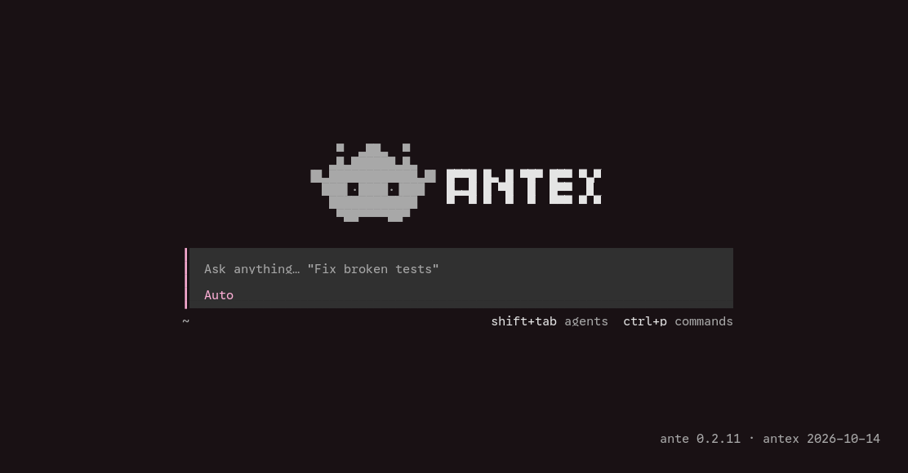

# ANTEX = OpenTUI + Ante

**把 opencode v2 自带的 TUI 接到 [Ante](https://github.com/AntigmaLabs/ante) 后端上跑。**
界面、主题、键位全用 opencode 的，数据全来自 Ante——中间这层垫片（`antex`）实现 opencode 的 server API。

[](https://github.com/jianlongliu/antex/releases)
[](LICENSE)
[](#装包ci-产物)
[](#依赖与版本)
[](#依赖与版本)




> 最后核对：2026-10-22 · 目标客户端 opencode 2.0.29 · Rust 1.99.1

---

## 目录

- [这是什么](#这是什么)
- [功能](#功能)
- [快速开始](#快速开始)
- [装包（CI 产物）](#装包ci-产物)
- [为什么这么做](#为什么这么做)
- [待定与遗弃](#待定与遗弃)
- [依赖与版本](#依赖与版本)
- [目录结构](#目录结构)
- [细节去哪了](#细节去哪了)
- [常见问题](#常见问题)
- [致谢与许可](#致谢与许可)

## 这是什么

```
opencode 的 TUI（本仓库自己编的，改了 logo）      ← 界面
        ↕  opencode 协议（本仓库实现的「垫片」）
antex（垫片，本仓库，一个二进制）
        ↕  ante-sdk / `ante serve --stdio`
Ante（**你自己装的**：官方脚本装、`ante update` 升级）
```

**Ante 不在本仓库里，也不用管它**——你装你的、它更它的，垫片按它的协议趴在上面。
唯一耦合点就是协议：若 Ante 升级改了协议，改垫片即可（通常只动 `Cargo.toml` 里的 `ante-sdk` 版本 + `cargo build`）。

## 功能

垫片把 Ante 的真事件翻译成 opencode 协议——界面里看到的每一条都是真数据，不是模拟。逐条实现细节与验证法在 [docs/implementation.md](docs/implementation.md)。

| 功能 | 说明 |
| --- | --- |
| **真数据流** | 起界、提示词送达、流式文本、推理、工具调用、审批、失败可见——全由垫片喂 Ante 的真事件，不是模拟 |
| **会话** | 列表、恢复、恢复后继续、删除（`Ctrl+D` 两下）——删的是 Ante 自己那条存档目录；**打开一条会话即从它的 `events.jsonl` 重建整份记录**（每一步的思考、回答、工具都在，见 [docs/implementation.md](docs/implementation.md) 的「记录回读」） |
| **插嘴与排队**（`Ctrl+S`） | 把排队消息插进正在跑的回合，带斜体 `Pending...` 角标；送到时机按 Ante 的真实边界判——**收下不算，下一个 step 开始才算模型读到** |
| **输出速率**（`· N tok/s`） | 每步行尾的均值。客户端的算式是 `Σ(output+reasoning) ÷ Σ(streamed−created)`，而 Ante **从不落盘「第一个 token 何时到」**，所以两个时刻都由垫片反推：`created` 取派发锚点（回合开始或上一个工具返回），`streamed` 取该次调用 `UsageUpdate` 到达的时刻。**每步都必须有标记**（客户端是 `durations.length !== steps.length` 硬门槛，缺一步整个回合不显示），实时 pump 与 `events.jsonl` 回放两条路都发 |
| **思考档位**（`/variants`，别名 `/thinking`、`/effort`） | opencode 的档位选择器就是 Ante 的 effort：`/api/model` 报出每个模型的档位梯子（Ante 的 `min`…`max`），选中后经 `POST /api/session/{id}/model` 的 `variant` 落到 `SessionUpdate.model.effort`（新会话的首次回合走 `StartSession`）。列表回报的是 **Ante 实际在跑的档位**——provider 支持不了会被它向下取整 |
| **供应商登录**（`/connect`） | Ante 的供应商登录被翻译成 opencode 的 integration 接口：`/api/integration` 由 `ante catalog` 的**合并目录**生成（每个带 `env_key` / `oauth_preset` 的 provider 就是一条）；`connect/key` 写进 `auth/api_keys.json`，`connect/oauth` 分三种——**ChatGPT 由垫片自己跑 Codex OAuth**（client id / 回调 / `codex_cli_simplified_flow` 全取自 Ante 二进制）、**Antix 交给 `ante auth login antix`**、其余（Anthropic 订阅）明确报「还没实现」。凭证落 `~/.ante/auth/`，格式与 Ante 自己写的逐字一致；`/api/credential` 的列表与删除也接上了 |
| **模型 / 供应商列表** | 按「连得上的」喂：`/api/model`、`/api/provider` 读 `ante catalog` 的合并目录，再筛掉没凭证的（Ante 自己的 `/providers` 就是这个口径）——所以 `/connect` 签完 ChatGPT 就能在 `/models` 里选到它 |
| **侧栏额度面板**（`▼ Quota`） | DeepSeek 余额、Command Code 的 5h/W/M + 余额、ChatGPT 订阅窗口、OpenCode Go 用量；数据垫片自己取（`src/quota.rs`），界面是自编客户端里的一块**内置插件**（`feature-plugins/sidebar/quota.tsx`）。**配过凭据的才显示**——没凭据、或凭据在但订阅用不了（401/403）的那几家整块不出现，`Unavailable` 只留给真故障。取数走 `POST /api/rpc/antex.quota/panel`（生成式 client 里唯一「任意 id + 任意方法」的通路，客户端补丁因此不必改生成代码），按 provider 缓存：成功 5 分钟、失败 60 秒，每 60 秒与每个 step 结束时刷新；凭据取环境变量 → `auth/api_keys.json`，ChatGPT 用 `/connect` 落下的 `auth/openai.json`（过期现刷、不写回）。**不装 opencode 插件**：插件那份的取数半边跑在 opencode 自己的 server 里，垫片不跑 JS（理由见 [docs/pitfalls.md](docs/pitfalls.md)） |
| **贴图** | 粘贴即发。Ante 侧有硬上限（≈240KB base64、≈170KB 原文件），垫片先压到 160KB 以内，压不下就明说 |
| **断线重连** | 退避重连 + `/api/health` 说真话 + 转录里一行说明，掉线期间排队的消息不丢。**回合没跑完就被杀掉的会话（盘上只剩 `events.jsonl`）Ante 打不开**，这种会话会新开一条继续 |
| **终端不会被占住** | 一体化模式下垫片被信号杀死、或客户端自己崩掉，终端都会回到可用的 shell：可捕获的信号（`TERM`/`INT`/`HUP`/`QUIT`）由垫片转给客户端，客户端自己把 raw mode 放回去；连 `SIGKILL` 也管得住——Linux 上客户端被 `PR_SET_PDEATHSIG` 绑在垫片上，内核替我们发信号（**macOS 没有这个机制，`SIGKILL` 那条仍会留孤儿**）。垫片另存一份 termios 兜底。**修之前**客户端会变成孤儿霸着 tty、停在 `Connection lost…` 覆盖层，而且 raw mode 下 `ISIG` 关着，**Ctrl+C 也不产生信号** |
| **常用命令** | `/compact`、`/rename`（走 Ante 自己的 `SessionUpdate.title`，别的前端也看得到；只有当前这条会话能这样改，别的会话改名落垫片自己的 `title.txt`）、`/copy`、`/export`（`GET …/experimental/session/{id}/export` 直接回垫片手上那份转录，`sanitize` 忽略——载荷本来就是 Ante 的日志，不重写路径）、`/stats`（数字全部来自 Ante 的 `meta.json`：会话数、token、活动日历、按 provider/model 分组；Ante 没写的报 0，协议里没有报价也没有子代理计数）、`/skills`（优先用 Ante 播报的技能清单——那是真能调用的集合，含项目域与 `no_skills`；首轮提示词之前才退到磁盘扫描） |
| **交互** | 模型选择、`shift+tab` 权限模式、`@` 文件补全、Herdr 状态上报、boot 接口全套。多标签**临时**关掉（`tabs.mode = "off"` 只是个配置项，不是能力——它要服务端同时驱动多条会话，垫片只有一条连接；真做多标签见[待定与遗弃](#待定与遗弃)） |
| **回溯**（`/undo`、`/redo`） | 客户端的两步 revert 接到 Ante 的 `Op::RewindSession`：`/undo` 只登记边界、下一次提交才真正截断（**Ante 会改写自己的 `events.jsonl` 与 `meta.json`**，不是前端遮一层），`/redo` 撤掉未提交的那次。边界 id 要从客户端的 message id 翻成 Ante 的 turn id，靠发提示时埋的对照表；只认本会话发出的提示，恢复来的旧对话会明说回溯不了 |
| **`!` 命令**（composer 里 `!cmd`） | 直接跑一条 shell 命令，输出与退出码进转录，`Command exited with code N` 单独一行。走 `POST /api/session/{id}/shell` ↔ Ante 的 `Op::ShellInput`（**一个请求换一个 `ShellOutput`**），所以这个请求**会一直挂着直到命令跑完**——客户端本来就拿「HTTP 返回」当完成信号。`/api/shell/{id}` 与 `…/output` 也接了，输出只有一页（跑完才有，没有实时尾巴可翻）；**命令也留在 Ante 的日志里**，重新打开会话时那行还在。**回合进行中不让跑**（回 409 + 原因）：Ante 一次只驱动一个回合，硬塞会和它的事件搅在一起 |
| **MCP 服务器**（`/mcps`、侧栏 `▼ MCP`） | **三条要知道的**：配在 `~/.ante/settings.json` 的 `mcp_servers` 里（不是 opencode 的配置）；**第一个提示词之前列表是空的**（Ante 侧的会话要等首个 prompt 才启动、才连服务器）；**面板里不能启停**，只能在那个文件里改完再开新会话。细节：Ante 按会话连服务器，连上后经 `ExtensionRefreshed` 把**每个服务器与它的工具**报给垫片（`McpServerInfo`，含远程服务器的 `url`）——垫片记下来，按客户端的 `Mcp.Server` 形状答 `/api/mcp`（有工具＝`connected`，没工具＝`failed`），并在每次 `ExtensionRefreshed` 后发一条带 location 的 `mcp.status.changed` 让面板刷新。**启停做不了**：Ante 的协议里没有运行时开关，服务器固定来自 `settings.json`、每会话连一次，所以 `connect`/`disconnect`/`add`/`remove` 一律回 400 + 一句写明改哪儿，而不是假装成功 |
| **不装样子** | Ante 没有的概念（LSP、VCS、终端、子代理会话）从界面里摘掉，而不是留个点了没反应的入口——插件 / 键位 / 命令黑名单 / 侧栏卡片四层，见 [docs/client-patches.md](docs/client-patches.md) 的「屏蔽做不了的入口」 |
| **两个平台** | CI 出 Arch 包 + macOS（Apple Silicon）tar.gz，见[装包](#装包ci-产物) |

## 快速开始

### 0. 前置：Ante 后端

antex 只是前端那一层，**Ante 要你自己装**（官方脚本装到 `~/.ante/bin`，`ante update` 升级）。
`antex` 启动时会先核对它：找不到 `ante` 直接报错退出。

### 1. 装 antex

**Arch（推荐，日常就这么用）**——从 [Releases](https://github.com/jianlongliu/antex/releases) 取包：

```sh
pkexec pacman -U antex-<版本>-1-x86_64.pkg.tar.zst
```

**macOS（Apple Silicon）**——取 `antex-<版本>-macos-arm64.tar.gz`，解包后把 `bin/` 里的三个文件放 `~/.local/bin`：

```sh
tar -xzf antex-<版本>-macos-arm64.tar.gz
cp antex-<版本>-macos-arm64/bin/* ~/.local/bin/
```

**源码**（改代码时才需要）：

```sh
cd ~/Projects/antex
cargo build --release        # crates.io 直连即可；只在本地 mihomo（127.0.0.1:7890）里通就先 export http_proxy/https_proxy
ln -sfn "$PWD/target/release/antex" ~/.local/bin/antex
```

### 2. 跑

日常就一条命令——**起服务并直接进 TUI，退出时服务一起停**：

```sh
antex
```

想分开（一个终端起服务、另一个连）也行：

```sh
antex serve 41999                             # 终端 A：只起服务，留在前台
opencode2 --server http://127.0.0.1:41999     # 终端 B
```

- `antex PORT` 指定端口（默认 41999）；`antex -h` 看用法，`antex -v` 看**后端 / 客户端 / 垫片**三方版本。
- **可以多开**：一体化模式下端口被占会**自动往后顺延**（并打印改用哪个），所以第二个、第三个 `antex` 直接跑就行。`serve` 模式相反——按你给的端口，被占就明确报错（换端口会让人连错服务）。
- 环境变量：`ANTE_BIN` 指定 `ante` 可执行文件（默认 `$PATH`，再退到 `~/.ante/bin/ante`）；`ANTEX_CLIENT` 指定客户端（默认 `~/.local/bin/antex-tui`，再退到 `opencode2` → `opencode`）。**所以不必先 export PATH。**
- **一体化模式下请求日志写 `/tmp/antex.log`**——写 stdout 会糊在 TUI 上；`serve` 模式仍打在 stdout。
- **启动自检**：找不到 `ante` 就直接报错退出（否则 TUI 能开、消息全石沉大海）；`ante --version` 与二进制里编进去的 `ante-sdk` **不在同一版本系列**（前两段，如 `0.2.x`）才**警告**。判据是**系列不是全等**：Ante 自己的版本与它发的 `ante-sdk` 本来就不同步（0.2.14 发的就是 sdk 0.2.14，但 0.2.11 发的是 sdk 0.2.10），比全等会每次启动都误报。运行期连不上、事件流断掉、消息被丢弃也写同一处日志，不留哑谜：`tail /tmp/antex.log`。

**macOS 上多两件事**（其余同上；已在 macOS 27 / arm64 上实测一条命令能起）：

```sh
export PATH="$HOME/.local/bin:$PATH"     # macOS 默认不带 ~/.local/bin；也可以直接写全路径 ~/.local/bin/antex
~/.local/bin/antex
```

- 一体化模式的日志落在 **`$TMPDIR/antex.log`**（macOS 的临时目录是 `/var/folders/...`，不是 Linux 那个 `/tmp/antex.log`）；`serve` 模式照旧打在 stdout。
- 从别的机器远程用它要带 `-t`（TUI 要 tty）：`ssh -t <mac> '~/.local/bin/antex'`。

## 装包（CI 产物）

打 tag 推上去，Actions 出两个产物挂到同一个 Release：

| 产物 | 平台 | 装法 |
| --- | --- | --- |
| `antex-<版本>-1-x86_64.pkg.tar.zst` | Arch | `pkexec pacman -U <包>`（放 `/usr/bin/{antex,antex-tui,opencode2}`） |
| `antex-<版本>-macos-arm64.tar.gz` | macOS（Apple Silicon） | 解包，把 `bin/` 里的三个文件放 `~/.local/bin`（垫片默认就在那儿找客户端），或把 `bin` 加进 `PATH`。**本机那台 Mac mini（macOS 27 / arm64）已实测**：起得来、连得上 Ante |

macOS 那份**只能在 macOS 上编**：垫片要 Apple SDK（Linux 上交叉编要自备 SDK，不划算），客户端是 bun `--single`，
那个脚本只给**同平台**出产物（`item.os !== process.platform` 直接跳过，见 `vendor/opencode/packages/cli/script/build.ts`）。
所以 CI 里跑在 `macos-latest`（arm64）——**不需要一台 Mac 去编**，只有要验跑起来才需要。

### 两个通道：预览与正式

版本号一律是 `日期 + 当日序号`，**通道由后缀区分**：

| 版本号 | 通道 | Release 标记 |
| --- | --- | --- |
| `2026.10.18` | 正式 | latest |
| `2026.10.18rc1` | 预览 | prerelease |

- **升级关系天然成立**：`2026.10.18rc1` < `2026.10.18rc2` < `2026.10.18`（Arch 的 `vercmp` 判定），
  所以装了预览版也能正常升到正式版；预览编号写两位数（`rc10`）同样正确。
- **正式版不会被预览顶掉**：GitHub 不允许 prerelease 成为 latest，所以 `/releases/latest` 始终指向正式版。
- 后缀只能用字母（`rc` / `beta` / `alpha` / `pre`），**别加点**：`2026.10.18.rc.1` 会被 `vercmp` 判成比 `2026.10.18`
  **更新**（点分开了新段），`pacman` 就会把预览当升级装上去。写成 `2026.10.18rc1` 才对。
- 正式版和预览版共用一个 `PKGBUILD` 的 `pkgver`，tag 必须逐字等于 `v$pkgver`（CI 会校验并拦下不一致的）。

## 为什么这么做

手写复刻 opencode 的 TUI 到不了它的完成度（它有 17k 行的界面层）。反过来做，垫片是**可丢弃**的一层：
上游界面升级时，重新拉 TUI 即可，只需跟着修垫片。代价是 Ante 没有的概念（LSP、formatter、git 操作）必须打桩
——`/connect` 不再打桩了：Ante 的供应商登录被翻译成 opencode 的 integration 接口（见[功能](#功能)）。
思路同「改接口，不改消费者」（参照 `onarchi`——把 Omarchy 真移植到 niri 的那个仓，原名 omarchy-on-niri）。

几条定下来的选择：

- **Rust 写垫片**：它是长驻进程，要稳、要单文件产物。
- **上游进同一个仓**（`vendor/opencode/`，git subtree，跟上游主线走）：升级即拉上游，本质就是打补丁。
- **只做垫片、不 fork 界面**：日常使用不必依赖自建前端（源码模式要 3.1G `node_modules`），**只有要改界面本身才必须 fork**。
- **映射原则**：Ante 真有对应概念的才做成真差别（`shift+tab`→权限模式、模型选择→provider/model）；没有的（LSP/formatter/VCS）打桩显示为空，不假装。

## 待定与遗弃

**空框 = 待定（做得到、还没做）；删除线 = 遗弃（Ante 底层没这个概念，别再提议硬做）。**已实现的部分在[功能](#功能)一节，逐条实现细节与验证法在 [docs/implementation.md](docs/implementation.md)。

### 待定

- [ ] 会话内 `/cd` —— **Ante 没有换目录的接口**：目录在建会话时由 `SessionRequest.cwd` 定死，`SessionUpdate` 里没有这个字段。会话内 `/cd` 走 `POST /api/session/{id}/move`，垫片回 400 + 一句「新建一个会话」的提示，TUI 原样弹在 toast 里；**没开会话时**的 `/cd` 是纯客户端行为（换的是界面目录），照常可用。退一步是「按新目录重开会话」（丢历史、会话列表多一行）
- [ ] `/fork` —— **做得到、还没做**：Ante 有 `Op::ForkSession` / `Evt::SessionForked`（附带 `SessionInfo.forked_from`）。客户端走 `POST /api/session/{id}/fork`（`before` ＝ 从哪条输入切），对应 op 的 `at`；fork 出来的是**新会话、不自动开始**，界面要跳到它（`/fork` 的导航语义）
- [ ] 真多标签（session tabs）—— **待定**：先验证 Ante 侧能否并发驱动多条会话，再谈垫片改造（现在只是把入口临时关掉）

### 遗弃

- [ ] ~~`/share`、`/unshare`~~ —— 云端分享，Ante 无此概念（客户端自己也直接报 "Sharing is not implemented for V2 sessions yet"）
- [ ] ~~`/status`~~ —— 无会话状态接口
- [ ] ~~`/pair`~~ —— 无设备配对（Ante 没有 pairing，`/api/pair` 只答空）。**`/connect` 已转正**，见[功能](#功能)
- [ ] ~~`/diff`、`/worktrees`~~ —— 无 diff / VCS / worktree 概念（`/api/vcs/*` 只能答空；`/api/vcs` 因此答**空分支** `{branch:{}}`，位置标签才不会挂上假 `:main`）
- [ ] ~~`/terminal`、Terminals 面板~~ —— 无 PTY：Ante 没有可交互的终端会话（`Bash` 是工具调用，`!cmd` 是跑完即止的一条命令，都不是终端）
- [ ] ~~`/plugins`、`/btw`~~ —— 无 opencode 插件系统；`/btw` 要的是「旁问」的独立 generate op
- [ ] ~~`/reload`、`/update`、`/restart`、`Ctrl+B` 后台化工具~~ —— 重新加载服务端配置 / 更新 opencode / 把工具调用扔后台，对 Ante 都无意义（**暂时遗弃**：等哪天有对应 op 再说）
- [ ] ~~LSP、formatter~~ —— 无对应概念，打桩显示为空（入口已摘；**暂时遗弃**）
- [ ] ~~子代理面板 / 点进子代理~~ —— 客户端的子代理 UI（内联块点进去看子会话、composer 的 subagents tab、mini 的 footer inspector）**整套都挂在「子代理 = 独立 child session」上**（`session.parentID` + 自己的事件流 + `sessionFamily()`）。Ante 没有这个概念：子代理只是父会话里的一次 `Agent` 工具调用，**内部活动不推给前端**（`ToolUpdate` 只在子代理排队等 slot 时才发，会话日志里基本没有），结果只在 `ToolEnd.result_json.report` 里一次交付；协议里也没有 agent id / parent turn（`SessionInfo.subagents` 只是可委派清单）。硬造 child session 只有空壳，还会污染会话列表。能做的只有把 `Agent` 调用按客户端的 subagent 块渲染（已做）

## 依赖与版本

工具链（本机实测，pacman 的 `rust` 包）：

| 项 | 版本 |
| --- | --- |
| rustc / cargo | **1.99.1**（Arch `rust 1:1.99.1-1`） |
| edition | **2024**（`let` 链语法需要，改回 2021 会编译失败） |

Cargo 依赖（`Cargo.lock` 实际解析值，非 `Cargo.toml` 的约束范围）：

| 依赖 | 版本 | 用途 |
| --- | --- | --- |
| axum | 0.8.9 | HTTP 路由与 SSE |
| tokio | 1.53.1 | 运行时（features: macros, rt-multi-thread, sync, time, process, io-util） |
| tokio-stream | 0.1.19 | 广播转事件流（**必须开 `sync` feature**，否则找不到 `BroadcastStream`） |
| serde | 1.0.229 | 派生（features: derive） |
| serde_json | 1.0.151 | 信封与事件载荷 |
| futures | 0.3.34 | 流拼接 |
| ante-sdk | 0.2.14 | 连 Ante（`Op`/`Evt` 协议）；版本跟着 Ante 的 0.2.x 走 |
| reqwest | 0.12.28 | `/connect` 的 OAuth 往返、额度面板取数（rustls） |
| image | 0.25.10 | 贴图压缩（png/jpeg/gif/webp/bmp/tiff） |
| base64 | 0.22.1 | 内联 `data:` URL 的收发 |
| sha2 | 0.10.9 | 附件去重 |
| chrono | 0.4.45 | 读 Ante 日志里的 RFC3339 时间戳 |

外部依赖：

| 项 | 说明 |
| --- | --- |
| 网络 | 本机现在**直连即可**（代理在路由器上做透明转发）。若哪天又只用本地 mihomo，再 `export http_proxy=https_proxy=http://127.0.0.1:7890`——`script/*.sh` 已改成「只有 7890 真在监听才设代理」 |
| opencode 客户端 | **2.0.29**，来自本仓库 `vendor/opencode/`（subtree 上游 tag `v2.0.29`），用 `script/build-tui.sh` 自编；官方脚本那份仍装在 `~/.opencode/bin`（`opencode`/`opencode2` 指向它，**2.0.18**，只作兜底） |
| 跟上游的口子 | `./script/upgrade-upstream.sh [ref]`——默认跟上游**主线**（默认分支 `dev`），也可传 tag（如 `v2.0.29`）。**原先跟的 `v2` 分支 2026-10-10 停更了**（版本停在 2.0.26），别再拿它当上游 |
| Ante | 接后端时用 **`ante-sdk` 0.2.14**——**已发布 crates.io**，直接写 `ante-sdk = "0.2.14"`（`^0.2.14`，跟着 Ante 的 0.2.x 走）。实测对着 Ante **0.2.14**；启动自检会比对两边的次版本号 |

## 目录结构

```
docs/                本 README 的细节分册（见下「细节去哪了」）
src/main.rs          垫片本体：路由、信封、SSE、会话/消息存储、事件翻译
src/attachments.rs   贴图：内联 data: URL ↔ Ante 的 @path 提及
src/integrations.rs  /connect：Ante 的供应商登录 ↔ opencode 的 integration 接口
src/quota.rs         侧栏额度面板的取数与排版
build.rs             把编译用的 ante-sdk 版本写进二进制（启动自检要用）
script/              build-tui.sh（重建客户端）、upgrade-upstream.sh（拉上游 + 重建，一条命令）、shot-home.py（把首页渲染成 PNG，README 那张图就是它出的）、tui_drive.py（在 PTY 里驱动客户端：按秒发键 + 抓最终屏文本，验收自动化探针）
vendor/opencode/     上游 opencode（subtree，跟主线）——魔改对象
Cargo.toml           axum + tokio + serde
```

## 细节去哪了

本 README 只留「是什么、怎么跑、现状」；实现过程、坑与验收按主题分册：

| 文件 | 内容 |
| --- | --- |
| [docs/implementation.md](docs/implementation.md) | 实现清单（逐条实测）· 未完成项的验证法 · 审批 · 验收与排错开关 · 下一步 |
| [docs/pitfalls.md](docs/pitfalls.md) | 关键坑 · v2 API 约定与事件名 · Herdr 集成 · 权威出处 |
| [docs/client-patches.md](docs/client-patches.md) | 客户端补丁（首页 logo、Pending 角标、命令黑名单…）· 屏蔽做不了的入口 · 客户端现状 · 魔改上游 TUI |

## 常见问题

**界面在跑，发消息却没反应？**
先 `tail /tmp/antex.log`（macOS 上是 `$TMPDIR/antex.log`）：启动自检那行会明说 `ante` 找没找到、版本是不是同一系列（例如
`自检：… → ante 0.2.14；antex 编译于 ante-sdk 0.2.14，同一版本系列`）。自检过了还没反应，就看日志里
「未连接 / 事件流结束 / 消息被丢弃」那几句——它不会静默。

**启动后模型列表要等几秒才出来？**
垫片喂模型/供应商列表时，每个请求都 spawn 一个 `ante catalog` 读合并目录（不缓存），TUI 起来时会并发拉三个；
而 `ante catalog` 这个进程自身要等 **OpenTelemetry 导出**——Ante 二进制里内嵌了 OTLP 端点，进程退出前要把指标刷出去，
网络一慢就是那几秒（同一二进制的 `ante --version` 只要几毫秒，可作对照）。

不想要遥测就把它关掉，`ante catalog` 会从秒级掉到十几毫秒：

```sh
export ANTE_TELEMETRY=off      # 写进 ~/.zshenv 之类对 antex 生效的地方
```

取值照 Ante 的约定：`off` / `false` / `0` / `disable` / `disabled`（大小写不敏感）。只停 OTLP 导出，Ante 自己的本地日志
（`~/.ante/logs/`）与功能都不受影响。验证：

```sh
time ante catalog              # 关掉前后差一个数量级
curl -s -o /dev/null -w '%{time_total}\n' localhost:41999/api/model
```

**贴的图模型说看不到？**
Ante 侧有硬上限：约 240KB base64（≈170KB 原文件）以上直接丢弃。垫片会先压到 160KB 以内，压不下会明说。
模型本身不看图（提示 `no vision support`）那是 catalog 里那个模型缺 `support_vision: true`，与体积无关。

**想装个 opencode 插件加功能？**
垫片**不跑 JS**：插件的取数半边跑在 opencode 自己的 server 进程里，装上去不会动。要加界面只有两条路——
改自编客户端（内置插件，见 [docs/client-patches.md](docs/client-patches.md)），或让垫片直接喂数据
（例如额度面板走的 `POST /api/rpc/…`）。

**侧栏额度显示 `Unavailable`？**
面板文案是英文（跟 TUI 走，见 [docs/client-patches.md](docs/client-patches.md) 的「文案语言」）。哪几家出现由凭据决定：

- **没凭据的不显示**。凭据取环境变量（`DEEPSEEK_API_KEY`、`CMD_API_KEY`/`COMMANDCODE_API_KEY`、`OPENCODE_GO_API_KEY`…）
  或 `~/.ante/auth/api_keys.json`；ChatGPT 那一行要先 `/connect`（认 `auth/openai.json`）。想隐藏某家，删掉它的凭据即可。
- **订阅不可用（401/403、没订阅）也不显示**——凭据在但这家用不了，跟没配一样收起来，原因写进垫片日志。
- 因此 `Unavailable` 只留给**真故障**（断网、超时、响应看不懂）：接口坏了要能看见，不能看着像「这家没了」。

**装完没生效 / 改了界面没变化？**
在跑的进程不会自己换二进制：装完包要重开 `antex`。改的是客户端源码（`vendor/opencode/`）时，还要先
`script/build-tui.sh` 重建，否则用的还是旧客户端。

## 致谢与许可

**TUI、键位系统、渲染、插件机制，连「用服务端 API 驱动一个现成客户端」这条路子本身**，全部来自
**opencode**（<https://github.com/sst/opencode>）。本仓库做的只是把它 git subtree 收进来、在「TUI 调后端」那一层
打几个补丁接到 Ante 上——等于站在人家肩上，上游不再更新，这里也就跟着停。感谢 opencode 的作者和所有贡献者。

许可跟上游一致（MIT，见 [`LICENSE`](LICENSE)）：随意分发修改。

___Powered by Deepseek___